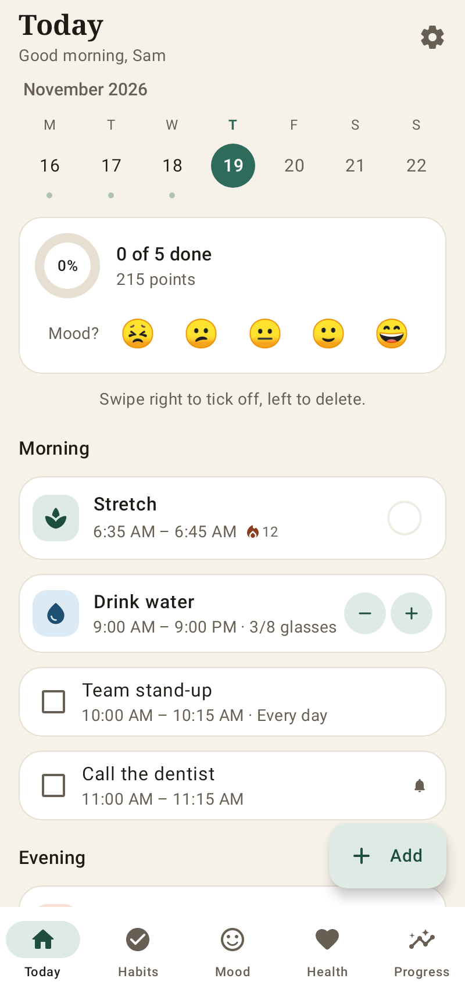
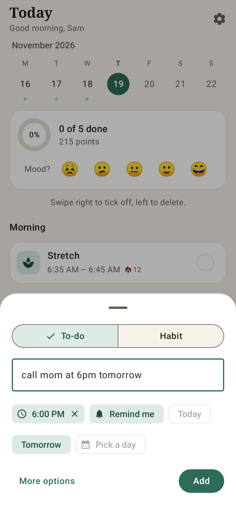
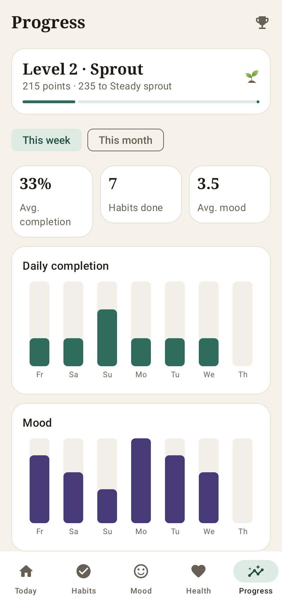

# Bloom for Android

A native Android version of Bloom, written in Kotlin with Jetpack Compose. It has no login and no server: everything is stored on the phone, and reminders are scheduled on the phone, so they arrive even when Bloom is closed and the phone is offline.

  

## Everyday use

- **Quick add.** Tap **Add**, pick To-do or Habit, and type one line. "Call mom at 6pm tomorrow" or "Drink water every day 9am" fills in the time, day and repeat, and turns on a reminder. Habits get an icon and color from their name. **More options** opens the full form.
- **Swipes.** On Today, swipe right to tick something off and left to delete it. Every delete has an **Undo**. On a repeating to-do, a left swipe skips only that day. The Habits list and mood check-ins can be swiped the same way.
- **Week strip.** Swipe it sideways to change week. Tap a day to see it. A dot under each day shows how much got done. When you're on another day, **Today** in the top bar brings you back.

## What changed from the web app

| Web app | Android app |
| --- | --- |
| Email and password accounts, JWT cookies, password reset by email | No account. A short first-run setup asks for a name, goals and starter routines |
| MongoDB on a server | Room (SQLite) on the phone |
| Web Push, which needs VAPID keys, a cron job or a worker, and an open browser | `AlarmManager` alarms set on the phone. No server and no internet permission |
| Reminders that only say "It's time" | Notification buttons: **Done**, **+1** (for count goals like 8 glasses) and **Snooze**. The mood reminder lets you log a mood with one tap, without opening the app |
| Cloud sync between devices | A JSON **backup and restore** file, plus Android's own app backup (`allowBackup`) |
| CSV download links | CSV export through the Android file picker |
| Service worker and install prompt | Not needed: it's an installed app |

These features carry over with the same rules: habits (daily, some days, or X times a week), from and to times, count goals, streaks, a 16-week heatmap, to-dos (one-off, multi-day and repeating, with "only this day" edits), templates, mood check-ins with emotions and triggers, a mood calendar, a journal with prompts and three good things, health (water, sleep, steps, weight), breathing and focus timers, challenges, points, levels, badges and insights. The water habit and the Health water count stay in step, as they did on the web.

## How reminders work

- `reminders/Reminders.kt` works out every reminder from now until the end of tomorrow: each habit and to-do with a reminder at its "from" time, the daily mood check-in, and the streak nudge.
- It sets an exact alarm for each one. Without the "Alarms & reminders" permission, it uses an inexact alarm, which can arrive up to 5 minutes late. Settings has a button to turn the permission on.
- The alarms are set again after every change to your data, just after midnight, after a reboot or app update, and when the clock or time zone changes.
- When an alarm fires, `ReminderReceiver` checks the item still isn't done before it shows anything. So if you finished a habit early, you won't get a reminder for it.

## Build and run

You need Android Studio (Ladybug or newer), or JDK 17+ and the Android SDK (platform 35).

```bash
cd android
./gradlew assembleDebug
```

The APK is written to `app/build/outputs/apk/debug/app-debug.apk`. To install it on a connected phone, run `./gradlew installDebug`. You can also open the `android` folder in Android Studio and press Run.

The release build (`./gradlew assembleRelease`) is minified and comes to about 1.5 MB. It's signed with the debug key so you can install it. Before you publish to Google Play, add your own signing key in `app/build.gradle.kts`.

## Tests

```bash
./gradlew testDebugUnitTest
```

- `LogicTest` checks dates, streaks (daily, some-days and weekly), count goals, repeating or multi-day to-dos, and how quick add reads times, days and repeats.
- `AppTest` runs the whole app under Robolectric. It renders each tab to a PNG in `app/build/screens/`, and checks that reminders are worked out and set as alarms, that notifications show the right buttons, that tapping **Done** in a notification completes the habit and syncs water, and that a finished habit isn't reminded again. It also adds a to-do through quick add, deletes one with a swipe and undoes it, ticks a habit off with a swipe, and renders Today and a habit's page on a small phone with large text.

## Layout

```
app/src/main/java/app/bloom/
  BloomApp.kt          app start: database, settings, notification channels
  MainActivity.kt      bottom tabs and navigation
  data/                Room entities and DAO, habit and to-do rules, catalog, points, backup and CSV
  reminders/           alarm scheduling, notification receivers and action buttons
  ui/                  theme (the web app's colors), shared components, screens
```
